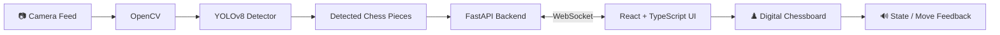

<div align="center">

# ♟️ Chess Vision AI

### Real-Time Chess Piece Recognition & Move Detection

**Computer Vision • YOLOv8 • OpenCV • FastAPI • WebSockets • React • TypeScript**

<br>


<br>

**A computer-vision system designed to recognize chess pieces from a live camera feed and build toward automatic board-state and move detection.**

</div>

---

## 🎯 Overview

**Chess Vision AI** explores how computer vision can transform a physical chessboard into a digitally understandable game state.

The project combines a custom-trained **YOLOv8 object detector** with an **OpenCV + FastAPI backend** and a **React/TypeScript interface**.

The current implementation focuses on:

- real-time chess-piece detection
- custom YOLOv8 model training
- camera-stream processing
- WebSocket-based communication
- visualisation through an interactive chessboard UI
- voice feedback for detected state changes

The next stage connects detected pieces to exact chessboard coordinates, allowing reliable board-state reconstruction and move recognition.

---

## 👁️ Model in Action

### Validation Predictions

<p align="center">
  
</p>

The YOLOv8 detector was trained to recognize black and white chess pieces from board imagery.

---

## 🧠 How It Works



### Detection Pipeline

**1. Capture**

Frames are acquired from the camera and processed using OpenCV.

**2. Detect**

A custom YOLOv8 model performs chess-piece object detection.

**3. Communicate**

Detection results are transferred through a FastAPI WebSocket endpoint.

**4. Visualize**

The React interface presents system state through a digital chessboard and detection interface.

**5. Track**

Board-coordinate mapping and robust move-state tracking form the next stage of the pipeline.

---

## 📊 Model Training Results

<p align="center">
  
</p>

### Confusion Matrix

<p align="center">
  
</p>

These artifacts are generated from the model-training run and are included in the repository for evaluation and reproducibility.

---

## ✨ Core Features

### 👁️ Computer Vision

- YOLOv8-based chess-piece detector
- custom model-training pipeline
- confidence-based object detections
- OpenCV frame processing
- validation and training visualisations

### ⚡ Real-Time Backend

- FastAPI backend
- WebSocket communication
- live image processing
- JSON detection responses

### 🖥️ Interactive Frontend

- React
- TypeScript
- Vite
- Tailwind CSS
- camera interface
- digital chessboard
- live connection status
- detection feedback
- voice notifications

---

## 🏗️ Tech Stack

| Layer | Technologies |
|---|---|
| **Computer Vision** | YOLOv8, OpenCV, NumPy |
| **Machine Learning** | Ultralytics YOLO |
| **Backend** | Python, FastAPI |
| **Real-Time Communication** | WebSockets |
| **Frontend** | React, TypeScript |
| **UI** | Tailwind CSS, Lucide React |
| **Build Tool** | Vite |

---

## 📁 Project Structure

```text
real-time-chess-move-detection/
│
├── backend/
│   ├── main.py
│   ├── train.py
│   ├── requirements.txt
│   │
│   └── runs/
│       └── detect/
│           └── chess_detector/
│               ├── weights/
│               │   ├── best.pt
│               │   └── last.pt
│               ├── results.png
│               ├── confusion_matrix.png
│               └── validation outputs...
│
├── src/
│   ├── components/
│   ├── utils/
│   ├── App.tsx
│   └── main.tsx
│
├── package.json
├── tailwind.config.js
├── vite.config.ts
└── README.md
```

---

## ⚙️ Getting Started

### 1. Clone the repository

```bash
git clone https://github.com/VineetBESTMAN/real-time-chess-move-detection.git
cd real-time-chess-move-detection
```

### 2. Backend Setup

```bash
cd backend

python -m venv venv
```

Activate the environment.

**Windows**

```bash
venv\Scripts\activate
```

**Linux / macOS**

```bash
source venv/bin/activate
```

Install dependencies:

```bash
pip install -r requirements.txt
```

Start the backend:

```bash
python main.py
```

The FastAPI service runs on:

```text
http://localhost:8000
```

and exposes the WebSocket endpoint:

```text
ws://localhost:8000/ws
```

---

### 3. Frontend Setup

From the project root:

```bash
npm install
npm run dev
```

Open the Vite development URL shown in the terminal.

---

## 🧪 Training the Detector

The repository includes a training script for the YOLOv8 model.

Dataset structure:

```text
dataset/
├── train/
│   ├── images/
│   └── labels/
├── valid/
│   ├── images/
│   └── labels/
└── test/
    ├── images/
    └── labels/
```

Run:

```bash
python train.py
```

Training outputs—including model weights, precision/recall curves, confusion matrices and validation predictions—are stored under the YOLO run directory.

---

## 🗺️ Development Roadmap

```text
✅ Chess-piece object detection
✅ Custom YOLOv8 training
✅ OpenCV camera processing
✅ FastAPI backend
✅ WebSocket communication
✅ React / TypeScript interface
✅ Digital chessboard UI

🔄 Robust board-square localisation
🔄 Piece → chess-square mapping
🔄 Persistent board-state reconstruction
🔄 Reliable move detection
🔄 Capture detection
🔄 Legal-move validation
🔄 Game-state tracking
🔄 Optional chess-engine integration
```

---

## 💡 Why This Project?

Physical chess contains useful information that traditional chess software cannot directly understand.

This project explores the bridge between:

```text
Physical Board
      ↓
Computer Vision
      ↓
Object Detection
      ↓
Board Reconstruction
      ↓
Move Recognition
      ↓
Chess Intelligence
```

It combines **machine learning, computer vision, backend engineering, real-time communication and frontend development** in one system.

---

## 👨‍💻 Author

### Vineet Madan

Interested in **AI Engineering, Computer Vision, Agentic AI and intelligent software systems**.

[GitHub](https://github.com/VineetBESTMAN) •
[LinkedIn](https://www.linkedin.com/in/vineet-madan-583ba6168/)

---

<div align="center">

### ♟️ From pixels to pieces. From pieces to moves.

**Built with YOLOv8, OpenCV, FastAPI & React**

</div>
